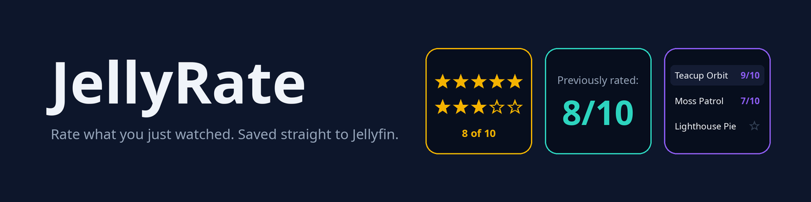
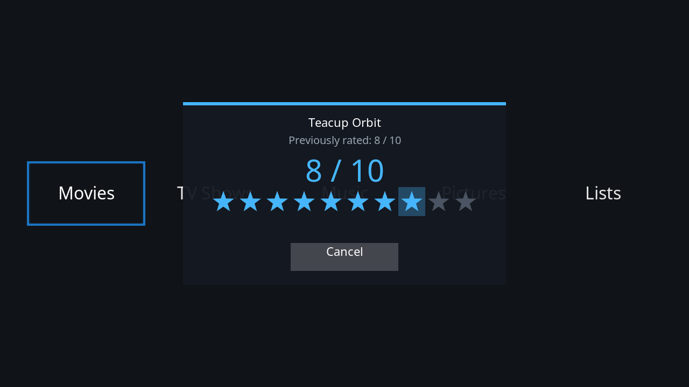
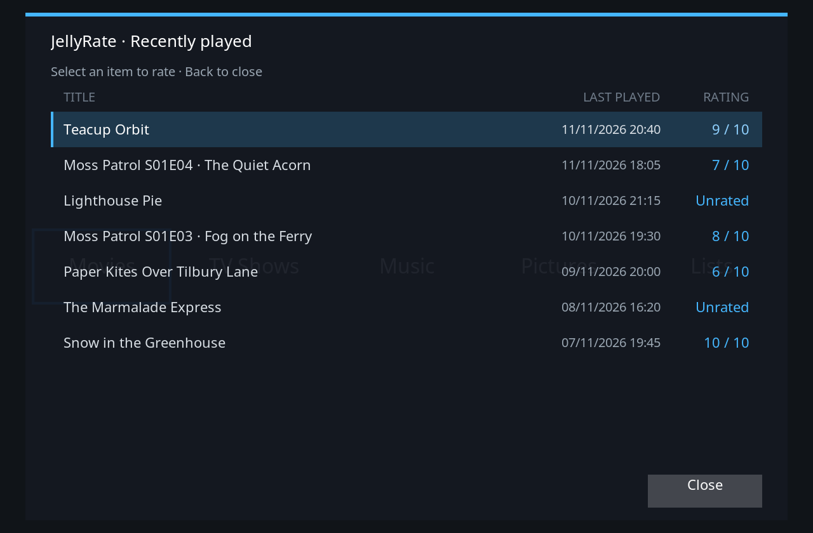

<a href="#quick-start">Quick start</a> · <a href="#how-it-works">How it works</a> · <a href="#settings">Settings</a> · <a href="#limitations">Limitations</a> · <a href="https://github.com/c0def0rc0ffee/JellyRate/releases">Changelog</a> · <a href="docs/">Docs</a>

  
  
  
  
  

A Kodi add-on that pops up a 1 to 10 star rating when a film or episode ends and saves it to Jellyfin, with no setup beyond Jellyfin for Kodi.

## Quick start

You need Kodi 19 (Matrix) or newer and [Jellyfin for Kodi](https://github.com/jellyfin/jellyfin-kodi) installed and **signed in**, in *add-on (native)* sync mode.

1. Install the [DeliciousCoffee repository](https://github.com/c0def0rc0ffee/DeliciousCoffee), then JellyRate from it. Kodi keeps it updated.
2. Or download `service.jellyrate-x.y.z.zip` from [Releases](https://github.com/c0def0rc0ffee/JellyRate/releases) and use **Settings > Add-ons > Install from zip file**. Flatpak Kodi: see [docs/flatpak.md](docs/flatpak.md).

The service starts on its own. Watch something to the end.

## What it does

- **Prompts after playback:** ten stars appear once you have watched at least 70% (adjustable), at the end or when you stop early.
- **Remembers your score:** a title you rated before opens on that score and shows *Previously rated: X / 10*.
- **My Ratings browser:** open JellyRate from Program add-ons to see recently played titles with their scores and re-rate any of them.
- **Optional JellyStat tie in:** scores also reach [JellyStat](https://github.com/c0def0rc0ffee/JellyStat), whose dashboard can manage JellyRate.

  
  

## How it works

- A background service watches playback end or stop.
- The Kodi item is matched to its Jellyfin id through Jellyfin for Kodi's own database.
- The score is saved as your per user rating, using the login Jellyfin for Kodi already stored.
- With a playlist or autoplay, prompts wait until nothing is playing, then appear in order.

Detail, including the endpoint: [docs/how-it-works.md](docs/how-it-works.md).

## Settings

Under **Add-ons > My add-ons > Program add-ons > JellyRate > Configure**.

| Setting | Default | Meaning |
|---|---|---|
| Enable rating prompt | On | Master switch |
| Also prompt when you stop early | On | Prompt on Stop, not just the natural end |
| Only prompt after watching at least (%) | 70 | Skip the prompt for brief plays |
| Also save the score in JellyStat | On | Records the score in JellyStat too, when installed |
| Default rating shown on the stars | 5 | Where the stars start |
| Allow JellyStat to manage JellyRate | On | Lets JellyStat's dashboard on this Kodi change settings and re-rate; local only |

Full text: [docs/settings.md](docs/settings.md).

## Works with JellyStat

With [JellyStat](https://github.com/c0def0rc0ffee/JellyStat) installed, its dashboard can change these settings and re-rate your 100 most recently played titles. Details: [docs/jellystat.md](docs/jellystat.md).

## Limitations

- The score is stored in Jellyfin's per user `UserData.Rating`. It is real and available through the API and some clients, but the Jellyfin web UI does not show it.
- Only items that came from Jellyfin can be rated; local only items are skipped.
- Films, episodes and music videos are supported.
- With several servers signed in, the one Jellyfin for Kodi used most recently is rated against.

## Licence

MIT, see [LICENSE](LICENSE).
